<div align="center">
<table style="width:100; border:none;">
    <tr>
    <td align="left" style="border:none; width:20%;">
      
    </td>
    <td align="center" style="border:none; width:60%;">
    </td>
    <td align="right" style="border:none; width:20%;">
      
    </td>
  </tr>
</table>


# TECNOLOGICO NACIONAL DE MEXICO

## INSTITUTO TECNOLOGICO DE MILPA ALTA ll
<br>

### INGENIERÍA EN SISTEMAS COMPUTACIONALES

<br>
<br>

### ADMINISTRACION DE BASE DE DATOS
### DOCENTE. BOLLAS PAREDES DIEGO ALBERTO
<br>


### PRACTICA RECUPERACION CON MARIADB
<br>

### 5° SEMESTRE
<br>

### JOSE GONZALEZ GUADALUPE NO. C. 241190024 
<br>

### 25 de noviembre de 2026
 </div>
<br>
<div style="page-break-after: always;"></div>

--- 

## INTRODUCCION

En esta práctica se ponen a prueba la restauración mediante respaldos lógicos (`mariadb-dump`) y la recuperación apoyada en el registro binario (`binlog`) comprobando cómo recuperar datos confirmados incluso después de un borrado accidental.

<div style="page-break-after: always;"></div>

--- 

## DESARROLLO

**OBJETIVO.**

Hacer un respaldo de una base de datos, simular un desastre y recuperarla desde la terminal usando solo MariaDB.

- **`Parte A`**: respaldo y restauración con mariadb-dump.
- **`Parte B`**: recuperar también los datos posteriores al respaldo usando el binlog.

**`REQUISITOS`**

- MariaDB instalado y en ejecucion
- Una terminal con acceso a un usuarioadministrador de MariaDB
- Una carpeta de trabajo
Se creó la carpeta de trabajo `practica1` desde la terminal para almacenar los archivos de respaldo generados durante la ejecución.

```bash
mkdir practica1 && cd practica1
```
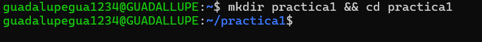

**PARTE A: RESPALDO Y RESTAURACION**

1. **Crear la base datos y los datos**

- Entrar a mariadb.
```bash
mariadb -u root -p
```
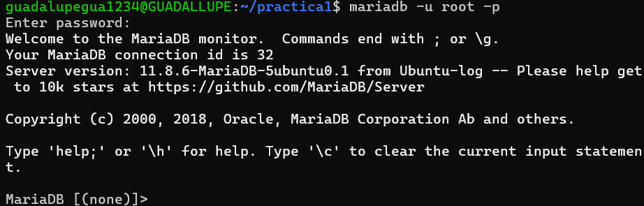

- Crear **`tienda`**, la tabla **`clientes`**, insertar los 5 registros y salir
```sql
CREATE DATABASE tienda;
USE tienda;

CREATE TABLE clientes (
    id INT AUTO_INCREMENT PRIMARY KEY,
    nombre VARCHAR(100),
    email VARCHAR(100)
);

INSERT INTO clientes (nombre, email) VALUES
('Ana Torres', 'ana@correo.com'),
('Luis Perez', 'luis@correo.com'),
('Maria Gomez', 'maria@correo.com'),
('Carlos Ruiz', 'carlos@correo.com'),
('Sofia Diaz', 'sofia@correo.com');

SELECT COUNT(*) FROM clientes;
```
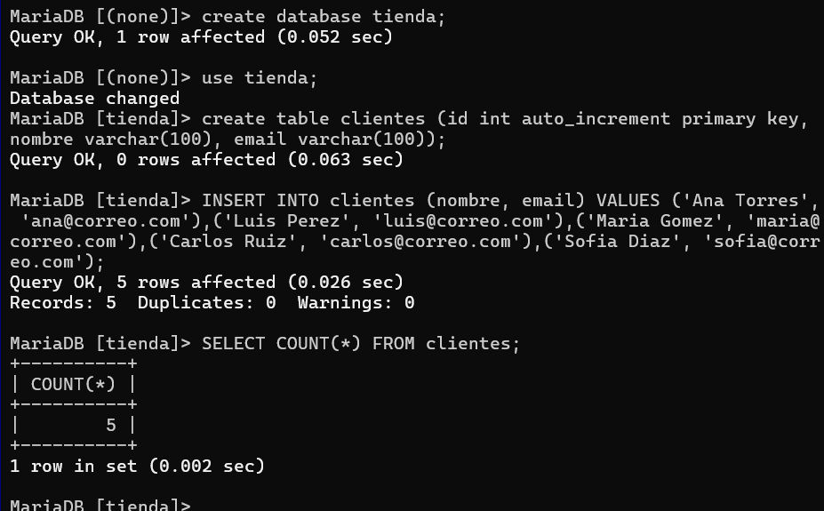

**`resultado que esperamos es 5`**

- Salir
```sql
EXIT;
```


2. **Hacer el respaldo**

- El siguiente codigo genera un respaldo lógico completo de la base de datos **`tienda`** y comprueba que el archivo se haya creado correctamente.
```bash
mariadb-dump -u root -p --databases tienda > tienda_backup.sql
```
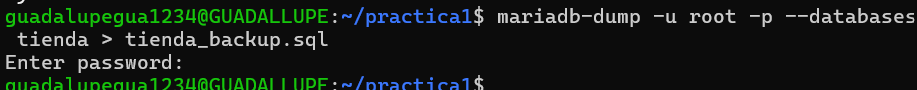

Primero se utiliza `mariadb-dump` autenticándose como el usuario root solicitando contraseña con -p e indicando con `--databases tienda` que se incluya tanto la estructura como los datos y la sentencia para recrear la base de datos redirigiendo toda esa salida hacia ``tienda_backup.sql``

- Comprobar que el archivo se creo.
```bash
ls -lh tienda_backup.sql
```
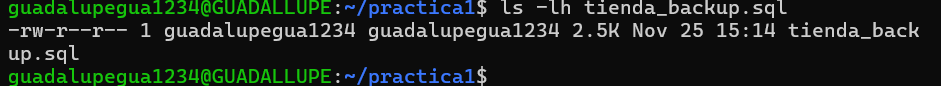

muestra los detalles del archivo en un formato legible para verificar que exista y tenga un tamaño mayor a cero.

3. **Simular el desastre**

- Entrar a mariaDB
```bash
mariadb -u root -p
```
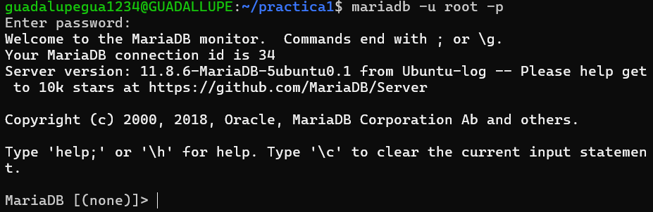

- Ejecucion de los comandos que simula la eliminación accidental de la base de datos
```sql
DROP DATABASE tienda;
SHOW DATABASES;
```
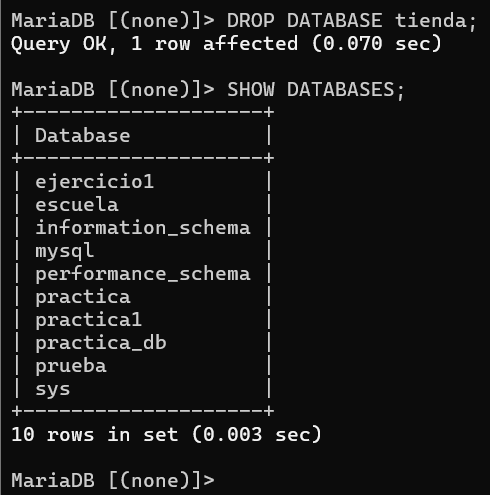

Con **`DROP DATABASE tienda;`** se borra permanentemente la base de datos **`tienda`** junto con su tabla **`clientes`** y todos los registros almacenados en ella.
Con **`SHOW DATABASES;`** permite comprobar en el listado del servidor que ya no existe cerrando finalmente la sesión interactiva de MariaDB con **`EXIT;`**

**`Resultado. la base tienda ya no aparece en la lista`**
- salir 
```sql
EXIT;
```


4. **Restaurar el respaldo**

- Con este bloque se restaura la base de datos eliminada a partir del archivo **`tienda_backup.sql`**
```bash
mariadb -u root -p < tienda_backup.sql
```
 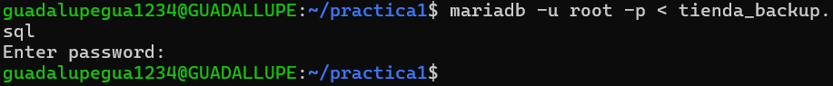

5. **Verificar la recuperacion**

- se comprueba directamente desde la terminal que la restauración del respaldo haya devuelto todos los registros originales a la base de datos
```bash
mariadb -u root -p -e "SELECT * FROM tienda.clientes;"
```
 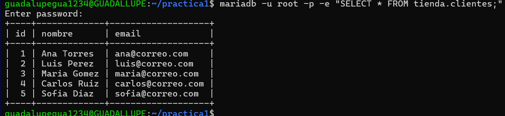

Se invoca el cliente **`mariadb`** con el usuario **`root`** pidiendo contraseña con **`-p`** y la opción **`-e`** permite ejecutar de inmediato la consulta **`SELECT * FROM tienda.clientes;`** sin entrar al modo interactivo mostrando en pantalla las filas almacenadas en la tabla clientes dentro de la base tienda para confirmar que los 5 registros iniciales fueron recuperados correctamente.

**`Resultado. aparecen los 5 registros que son los clientes.`**

**PARTE B: RECUPERAR DATOS POSTERIORES AL RESPALDO CON EL BINLOG**

1. **Activar el binlog**

-  abrir archivo de configuracion y editar.
```bash
sudo nano /etc/mysql/mariadb.conf.d/50-server.cnf
```
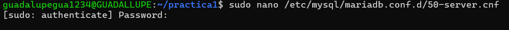

 - Debajo de `[mariadb]` agregamos lo siguiente:
```ini
log_bin = /var/lib/mysql/mariadb-bin
server_id = 1
```
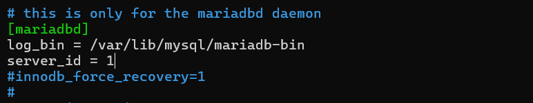

**`log_bin = /var/lib/mysql/mariadb-bin`** activa la bitácora de cambios en esa ruta
**`server_id = 1 `** identificador único del servidor necesario cuando se usa log_bin

- Guardar y reiniciar con el siguiente comando:
```bash
sudo systemctl restart mariadb
```


- verificar:

Sirve para comprobar directamente desde la terminal si el registro binario quedó activado (ON) en MariaDB después de reiniciar el servicio.
```bash
mariadb -u root -p -e "SHOW VARIABLES LIKE 'log_bin';"
```
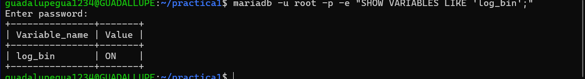

**`Resultado. log_bin = ON`**

2. **Hacer un respaldo que guarde la posicion del binlog**

- Genera el respaldo de tienda como root **`-u root -p`** rota el archivo del binlog al iniciar **`--flush-logs`** y guarda en el archivo la posición inicial del binlog **`--master-data=2`** dentro de **`tienda_pitr.sql.`**
```bash
mariadb-dump -u root -p --databases tienda --flush-logs --master-data=2 > tienda_pitr.sql
```
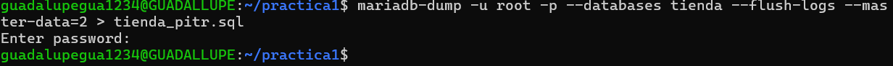

- ver el archivo y la posición del binlog que quedó guardada dentro del respaldo.
```bash
grep "CHANGE MASTER" tienda_pitr.sql
```
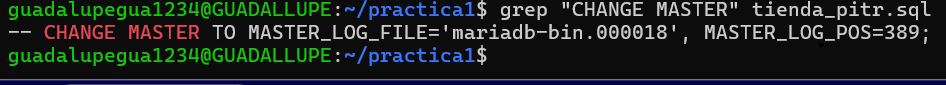

**`Resultado. nombre del archivo binario (mariadb-bin.000018), posición (389)`**

3. **Agregar datos nuevos (posteriores al respaldo)**

- abrir cliente de mariadb autenticado como **`root.`**
```bash
mariadb -u root -p
```
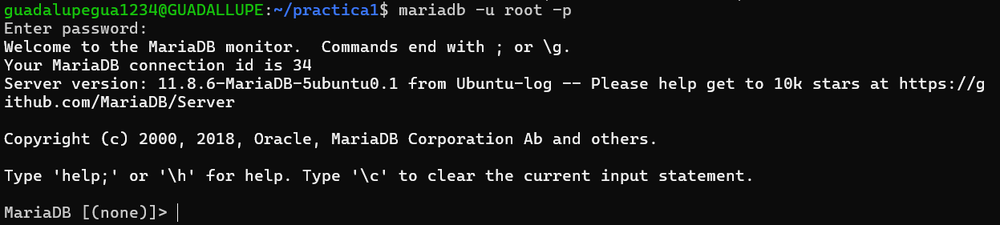

- Insertar los dos clientes nuevos y verificar que ahora haya 7 registros:
```sql
USE tienda;
INSERT INTO clientes (nombre, email) VALUES
('Pedro Nunez', 'pedro@correo.com'),
('Laura Vega', 'laura@correo.com');

SELECT COUNT(*) FROM clientes;
```
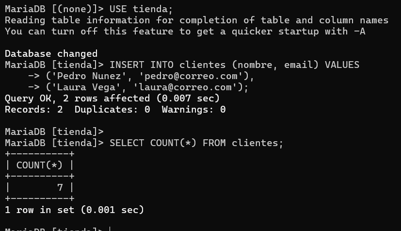

**`SELECT COUNT(*) FROM clientes;`** cuenta el total de filas en **`clientes`** para confirmar que hay 7 registros

**`Resultado. 7 registros`**

- consultar la hora con el siguiente comando:
```sql
SELECT NOW();
```
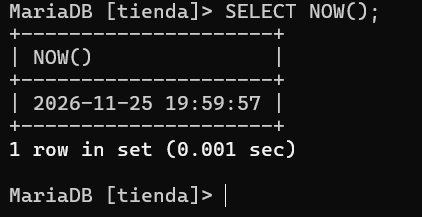

Muestra la fecha y hora actual del servidor para anotarla como punto de corte antes del borrado.
**`Resultado. 2026-11-25 19:59:57`**

4. **Simular el error**

- Elimina todos los registros de la tabla clientes para simular un borrado accidental posterior a la inserción de los dos nuevos clientes.
```sql
DELETE FROM clientes;
```
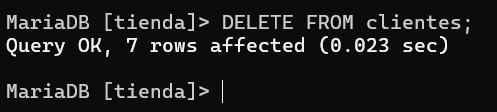

- Cuenta las filas restantes en clientes para comprobar que la tabla quedó en 0 registros.
```sql
SELECT COUNT(*) FROM clientes;
```
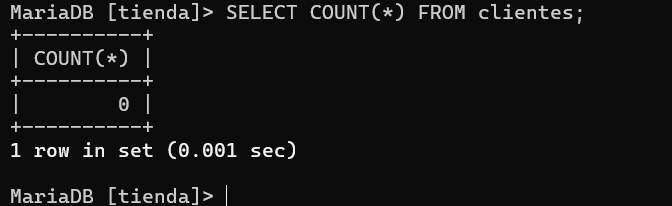

- salir


**`Resultado. 0`**

5. **Restaurar el respaldo**

- Restaurar la estructura y los datos de **`tienda`** tal como estaban al momento de generar tienda_pitr.sql.
```bash
mariadb -u root -p < tienda-pitr.sql
```
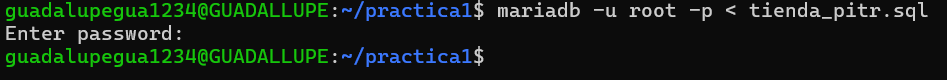

6. **Aplicar el binlog hasta antes del error**

- usamos la posicion y el archivo que se anoto anteriormente y la hora anotada.

Lee los eventos del binlog **`mariadb-bin.000018`** desde la posición **`389`** hasta antes de **`2026-11-25 19:59:57`** y los envía a MariaDB para recuperar las inserciones sin ejecutar el borrado posterior.
```bash
sudo mariadb-binlog --start-position=389 --stop-datetime="2026-11-25 19:59:57" /var/lib/mysql/mariadb-bin.000018 | mariadb -u root -p
```
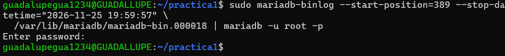

7. **Verificar**

- Consultar la tabla clientes y confirmar que volvieron a aparecer los 7 registros
```bash
mariadb -u root -p -e "SELECT * FROM tienda.clientes;"
```
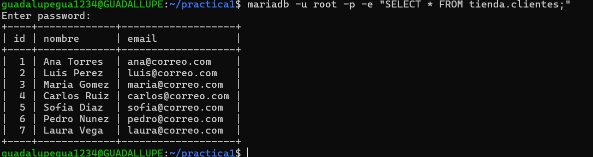

**`Resultado. 7 clientes, contemplando a pedro y laura`**

`parte b. se recupero todo excepto el delete accidental.`

**CONCLUSION**

En esta práctica comprobé que tener solo un respaldo completo no siempre basta cuando ocurre un error o un borrado accidental después de tomarlo, al combinar el respaldo base con el registro binarioy filtrar hasta la posición 389 y la fecha/hora 2026-11-25 19:59:57 en mi ruta /var/lib/mariadb/ logré recuperar los 7 registros de tienda.clientes sin repetir el DELETE.

 
